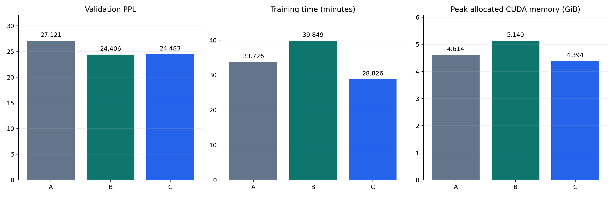
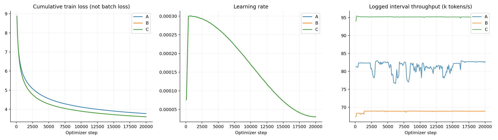
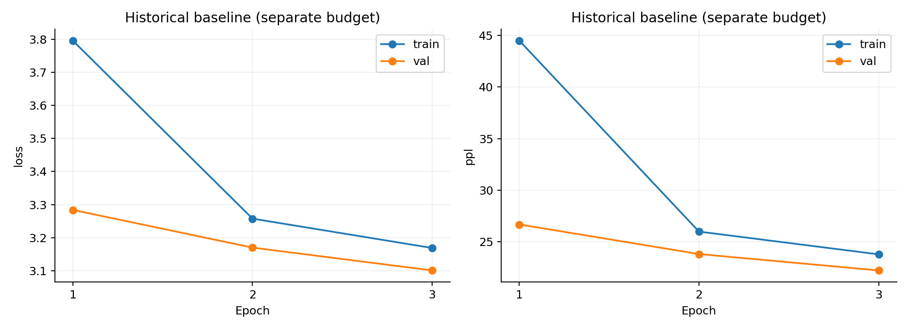

# 中文 MiniGPT 预训练与消融实验报告

报告日期：2026-09-15。依据磁盘中的实际实验记录编写；本次只整理、校验和可视化，没有重新训练或评估模型。

## 1. 实验目标与主要结果

项目用原生 PyTorch 实现中文 Decoder-only 语言模型，覆盖文章获取、质量过滤、去重、分词、流式存储、预训练、评估与自回归生成。目标是在单张 RTX 4070 上验证完整训练流程，并用相近参数量和相同 token 预算研究架构及注意力实现的影响。

本批 A/B/C 均完成 1 epoch、20,090 次更新、164,575,488 个目标 token 的训练，完整验证集评估也均完成。验证集最低 PPL 是 B 的 **24.4058**；C 的 PPL 为 **24.4834**，但相对 B 的整轮训练吞吐高 **38.24%**、训练阶段峰值 allocated 显存低 **14.52%**。

这支持“现代架构组合改善本批验证预测，SDPA 改善本机训练效率”的初步结论。只有一个随机种子和一轮预算，不能证明统计显著性、最终收敛质量或每个组件的独立收益。生成案例仍明显重复、偏题，尚不适合作为成熟聊天模型展示。

## 2. 数据与处理

输入为中文 Wikipedia JSONL，下载代码默认指向 `wikimedia/wikipedia` 的 `20231101.zh` 配置。当前处理元数据记录原始输入 100,000 篇，保留 99,883 篇，保留率 99.883%；质量拒绝 96 篇，其中低中文比例 95 篇、连续重复字符 1 篇。其余 21 篇未保留；精确/近似去重的分项数量没有写入当前元数据，不能仅凭本报告的 meta 来源分别核定。

| 集合 | 文档数 | 文件中 token 数 | seq_len=256 完整样本数 | 实际完整遍历目标 token 数 |
|---|---:|---:|---:|---:|
| train | 94,949 | 164,575,686 | 642,873 | 164,575,488 |
| val | 3,952 | 7,048,521 | 27,533 | 7,048,448 |
| test | 982 | 1,570,317 | 6,134 | 1,570,304 |

规范化采用 NFC、换行处理与首尾空白清理。默认过滤阈值：正文至少 50 字符、中文范围字符占非空白字符比例至少 0.1、异常控制字符比例不超过 0.01、最长连续重复字符占比不超过 0.2。正常换行、回车、制表符不作为异常控制字符；整体质量拒绝比例超过 0.8 时阻止发布。

精确去重使用规范化正文 SHA-256，近似去重采用字符 5-gram 抽样 SimHash 与四片段候选索引，汉明距离阈值 3。文档按 seed=42 的稳定哈希分配到 train/val/test，目标比例 95%/4%/1%；这是文档比例，不要求 token 比例恰好相等。

Tokenizer 是本地中文 BERT WordPiece，词表 21,128，指纹为 `1622a210c3290f4135211fcb8682f32ecffb55e86a52792f93e62a94d938a981`，边界 token 为 SEP，ID=102。数据存储为 uint16 连续流，按需映射为 memmap，读取后转 int64。每个窗口读取 257 个 token，前 256 个是输入，后 256 个是标签；尾部不足一个完整窗口的数据不参与评估。

文档内划分能避免同一完整文档直接跨集合，但近似去重是启发式，并不保证所有语义重复都已消除。每个 split 内的窗口可以跨文章边界，当前没有文档级隔离 attention mask。没有人工抽检统计，因此不宣称去重误杀率或清洗准确率已验证。

数据统计来自当时生成的 train、val 和 test 元数据，相关文件哈希见 [证据清单](docs/experiment_report/evidence.json)。实际处理数据的 bin 哈希保存在 [历史消融协议](experiments/ablation/protocol_lock.original.json)。默认语料来源见 [README](README.md#来源与许可证)。

## 3. 模型、预算与公平性

| 组 | 位置编码 | 归一化 | FFN | Attention | d_ff | 参数量 |
|---|---|---|---|---|---:|---:|
| A | learned | LayerNorm | GELU | manual | 2304 | 38,251,520 |
| B | RoPE | RMSNorm | SwiGLU | manual | 1536 | 38,089,216 |
| C | RoPE | RMSNorm | SwiGLU | SDPA | 1536 | 38,089,216 |

共同设置为 d_model=512、8 层、8 头、单头维度 64、上下文 256、dropout=0.1、输入 embedding 与输出 head 权重共享。GELU 与 SwiGLU 的主要投影矩阵数不同，所以分别使用 d_ff=2304 和 1536，使参数量接近；A 仍比 B/C 多约 0.43%，不是完全等参数实验。

训练设置：随机初始化、seed=42、batch_size=32、梯度累积=1、单卡；AdamW，betas=(0.9,0.95)、学习率 3e-4、矩阵参数 weight_decay=0.1、其余参数不衰减、梯度裁剪 1.0；warmup 比例 0.02、余弦衰减到基础学习率的 0.1；BF16、TF32 开启、可用的 fused AdamW、compile 关闭。三组最终学习率均为 3e-5。

每轮采样使用独立 seed+epoch 生成器，避免不同架构初始化消耗不同随机数而改变样本顺序。仍不保证架构不同后 dropout 消耗或数值运算轨迹相同。所有组训练预算、实际训练配置与完整验证指标已交叉检查。

| 环境项 | 保存的值 |
|---|---|
| GPU | NVIDIA GeForce RTX 4070 |
| Python | 3.10.20，Anaconda |
| PyTorch | 2.6.0+cu124 |
| CUDA 构建版本 | 12.4 |
| 训练/验证 AMP | BF16 |

CUDA 构建版本不等于驱动版本；运行记录没有保存完整依赖锁、当时驱动及功耗/频率等全部环境信息。三组跨不同时间执行，后台负载可能影响速度。

协议身份：`8ffbfc1477f3d42e49232d1cec3edbdf23c6651947b127954a84b8a3b17e2ccc`。默认配置 epochs 从 8 改为 3，不影响完整覆盖字段的组配置 epochs=1；2026-09-15 的修订仅调整此类过度校验并保存原协议，未改写 A 的训练记录。数据、训练源码和组配置保持哈希约束。

## 4. 定量结果

| 组 | Train Loss | Val Loss | Val PPL ↓ | 下一 token 准确率 ↑ | 训练耗时/分钟 | 端到端耗时/分钟 |
|---|---:|---:|---:|---:|---:|---:|
| A | 3.777569 | 3.300316 | 27.121221 | 39.8423% | 33.73 | 34.37 |
| B | 3.606599 | 3.194821 | 24.405815 | 41.2791% | 39.85 | 40.47 |
| C | 3.608309 | 3.197996 | 24.483418 | 41.2435% | 28.83 | 29.26 |

| 组 | 整轮训练 tokens/s ↑ | 峰值 allocated 显存/GiB ↓ | 完整验证 tokens/s |
|---|---:|---:|---:|
| A | 81,330.62 | 4.614 | 230,709.22 |
| B | 68,832.11 | 5.140 | 216,531.81 |
| C | 95,154.31 | 4.394 | 315,877.96 |



指标定义：Loss 为总 token 负对数似然除以目标数量，PPL=exp(Loss)，bits/token=Loss/ln(2)。代码对极高 Loss 的指数做截断，本批结果不触发。准确率是各位置 argmax token 与真实下一 token 相等的比例，不是问答准确率。

训练耗时覆盖整轮数据读取、前向、反向、更新与训练日志，不含轮末验证及 checkpoint 保存；端到端耗时还包括子进程启动、加载、初始化验证、保存等。显存为 PyTorch allocated 峰值，不是 nvidia-smi 的整卡占用。验证吞吐包括批量 teacher-forcing 前向与统计，不等于自回归生成速度。

### A → B：架构组合

B 的 Val PPL 相对 A 降低 **10.01%**，准确率增加约 **1.44 个百分点**。但训练吞吐降低约 15.37%，且显存增加。结论是本批预算下组合改善了验证预测，并非各项指标全面改善。

这个实验同时改变位置编码、归一化和 FFN，不能分别归因于 RoPE、RMSNorm 或 SwiGLU。参数量还存在小幅差异；拆解单项贡献需要更多消融。

### B → C：注意力实现

C 相对 B 训练吞吐提高 **38.24%**，训练时间减少约 **27.66%**，峰值 allocated 显存减少 **14.52%**。Val PPL 增加 **0.077603（0.318%）**，准确率低约 0.036 个百分点。

因此 C 展示了更好的本机训练效率；不能说它的模型效果优于 B，也不能把一次接近的 PPL 认定为统计等效。不同注意力实现的数值/随机行为差异可能累积，本报告没有证明具体差异来源。

若按验证 PPL 选模型，本批选 B；若更看重后续训练成本，C 是值得继续验证的工程候选。两者都尚未达到可可靠交互的生成质量。

## 5. 训练曲线



从每组 train_console.log 提取了 **200 个真实日志采样点**，对应 step 100 到 20,000，间隔 100。最终训练到 20,090，终点精确指标见轮末 JSON；未伪造最后 90 步的逐步数值。

左图为轮内累计 token 加权平均训练 Loss，不是当前 batch Loss，也不是滑动平均；它随训练累计而变得平滑，不能凭其平滑下降判断没有局部波动。中图为日志记录的学习率，三条线高度重合是预算一致的结果。右图为日志区间近似吞吐，不是独立稳定性能基准。

本批每组仅一个完整验证点。不存在每 100 步验证曲线，报告不插值补造。训练 Loss 是轮内不同参数状态的平均，验证 Loss 是轮末参数状态的测量，二者不能机械按间隙判断过拟合。单轮预算也不足以证明已收敛。

采样点可以在 [training_curve_points.json](docs/experiment_report/training_curve_points.json) 复查。

## 6. 固定提示词生成检查

每组使用相同 20 条提示词、greedy、最大新 token=80、KV Cache 开、重复惩罚=1.1、禁止重复 4-gram、最少新 token=0。生成代码没有使用训练时的 autocast，当前模型加载后的生成为默认参数精度路径；不能把这组吞吐称为 BF16 生成性能。

| 组 | 新 token 总数 | 生成 tokens/s | 平均 3-gram 重复率 ↓ | 结束符停止条数 |
|---|---:|---:|---:|---:|
| A | 1600 | 228.15 | 15.128% | 0/20 |
| B | 1600 | 107.56 | 13.974% | 0/20 |
| C | 1600 | 103.72 | 14.231% | 0/20 |

全部样例达到长度上限，说明这批提示下没有观测到自然边界停止。B/C 的重复率略低，但不代表内容正确。A 的记录生成吞吐明显更高，C 在这一单样本短序列生成测试中没有体现比 B 更快；不能把训练加速直接推广为推理加速。基准没有独立 warmup、多次重复、频率和后台负载控制，不确定性未量化，报告保留实际测量而不推断稳定速度排名。

以下是同一提示“中国的首都是”的真实输出开头，均为截取，不是模型完整回答：

- A：“中国的一个城市，也是中国第一个城镇。中国的第二大城市是中国最大的城市……”
- B：“中国的一个重要的城市。中国的第一座城市是中国第一座以中国最大的城市……”
- C：“中国的第一个城市，也是中国第一个拥有中国最大的城市。中国的城市包括……”

三组都没有在开头给出准确、直接的续写，并存在循环措辞或语义不通。B 后文虽出现北京，仍不能据此算作正确回答。人工智能主题的输出也混杂泛化套话和概念替换。这是定性失败分析，不是经过标注协议统计的错误率。

运行消融实验后，完整生成样例会汇总在本地 `outputs/ablation/REPORT.md`。

## 7. 历史 baseline：单独记录

历史 baseline 为 38.09M 的 RoPE/RMSNorm/SwiGLU/SDPA 模型，训练计划是 8 epoch，但实际日志记录到第 3 轮，累计 493,726,464 个目标 token。停止原因没有记录，不能写成完成 8 轮或基于验证指标自动早停。

| 轮数 | Train Loss | Val Loss | Val PPL |
|---|---:|---:|---:|
| 1 | 3.795574 | 3.283828 | 26.677693 |
| 2 | 3.257508 | 3.169959 | 23.806516 |
| 3 | 3.168774 | 3.100918 | 22.218329 |



历史完整 test 报告记录：Loss=3.067200、PPL=21.481666、下一 token 准确率=42.6651%，目标数 1,570,304。本次未重新评估历史 checkpoint，只引用保存的报告，不新增验证其权重来源的结论。

历史 baseline 的 token 预算、学习率日程以及当时采样实现与新批次不同。其 PPL 更低不能直接用于证明 C 相对 A/B 更好。旧日志未完整保存训练耗时与显存峰值，因此本报告不估算后填成实测值。

## 8. 可复现性与证据

已核对原消融协议中的数据/源码/组配置哈希、各组 completed 状态、相同 token 预算和训练环境；各 run_manifest 的训练/架构字段与组配置一致；独立完整 Val Loss 与轮末日志一致；原评估来源证明的 checkpoint 哈希通过检查。

报告使用的日志、配置清单、评估报告和元数据哈希保存在 [evidence.json](docs/experiment_report/evidence.json)。清单记录报告编写时读取的文件版本。公开仓库保留报告、图表、采样点与哈希清单，完整日志、原始数据和权重由本地实验产生。

重新运行三组对照的步骤见 [消融操作指南](experiments/ablation/README.md)。新运行按当前环境和输入建立新的协议锁。已经存在的训练目录会受到防覆盖保护。

保有原始实验记录的工作副本可从项目根目录运行以下命令更新图表和证据清单。

```sh
python experiments/build_experiment_figures.py
```

该脚本校验后重建三张图、采样点 JSON 和证据清单。本文分析为本批固定结果的人工整理正文，不会被脚本自动重写；更换实验结果后应同步修订本文。

## 9. 仍未完成的研究项

当前“实验报告与已有训练曲线”已具备可展示版本，但不等于全部研究问题完成：

- A/B/C 的独立 test 尚未评估，留空是为了避免用测试集反复选型，不影响本批验证集消融报告成立。若严格按最低 Val PPL 选 B，方案冻结后可以执行 `evaluate B --split test`，再更新报告。
- 只有 seed=42，没有多种子均值、标准差或显著性检验；没有更长预算下的收敛比较。
- 没有独立 AMP 对照、逐项 RoPE/RMSNorm/SwiGLU 消融；不宣称这些单项的收益。
- 没有标准任务准确率、人工盲评或聊天指令评测；下一步应补明确任务的 SFT 数据和留出测试。
- 性能为一次记录，未控制所有硬件状态；没有把生成首 token 延迟、稳态延迟和批量服务吞吐分开测量。

简历可以陈述本批的可核验变化：相近参数量、相同 1.646 亿训练 token 预算下，现代架构组合 Val PPL 相对传统组降低 10.01%；同架构采用 SDPA 后训练吞吐提高 38.24%、allocated 显存峰值降低 14.52%。同时注明单卡、单种子、一轮预算，不把这些数值写成通用性能保证。
