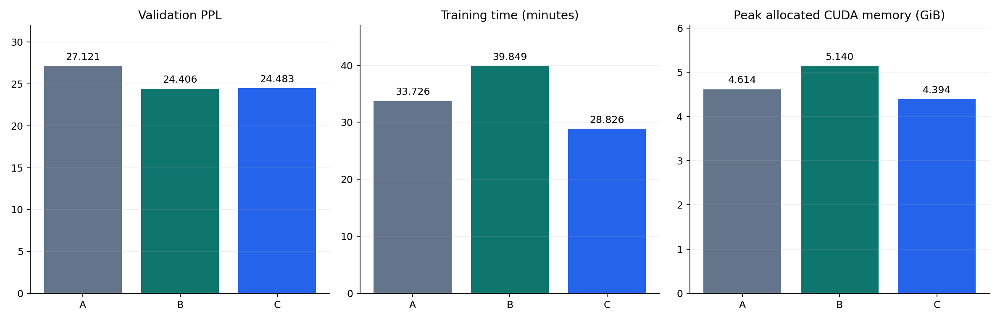

# MiniGPT 中文语言模型预训练

使用 PyTorch 从随机初始化训练 Decoder-only 中文语言模型。流程覆盖语料清洗、精确与 SimHash 近似去重、按文档划分训练/验证/测试集、memmap 读取、断点续训及 KV Cache 文本生成。命令行默认模型为 **38.09M 参数**，小样本配置可在 CPU 上运行。

## 训练实验

在单张 RTX 4070 上比较三组约 38M 参数的模型，每组使用 1.646 亿训练 token、一个随机种子和一轮训练。

| 组别 | 架构与注意力 | 验证集 PPL ↓ | 训练 token/s ↑ | 峰值已分配显存 ↓ |
|---|---|---:|---:|---:|
| A | Learned + LayerNorm + GELU，手写注意力 | 27.12 | 81,331 | 4.61 GiB |
| B | RoPE + RMSNorm + SwiGLU，手写注意力 | 24.41 | 68,832 | 5.14 GiB |
| C | RoPE + RMSNorm + SwiGLU，SDPA | 24.48 | 95,154 | 4.39 GiB |

同架构的 B → C 对照中，SDPA 将本次整轮训练吞吐提高 **38.2%**，峰值已分配显存降低 **14.5%**。这组实验测量的是训练性能。生成样例仍有重复和偏题。数据、测量口径、训练曲线和生成案例见[实验报告](EXPERIMENT_REPORT.md)。



## 快速开始

在项目根目录用 Python 3.10 或更新版本创建虚拟环境。

```sh
python -m venv .venv
```

Windows PowerShell 执行 `.\.venv\Scripts\Activate.ps1`。macOS 或 Linux 执行 `source .venv/bin/activate`。如需 CUDA 版 PyTorch，先按 [PyTorch 安装指南](https://pytorch.org/get-started/locally/)选择对应环境。

```sh
python -m pip install -r requirements.txt
python -m src.download_data --config configs/quickstart.json
python -m src.prepare_dataset --config configs/quickstart.json
python -m src.train --config configs/quickstart.json
python -m src.evaluate --config configs/quickstart.json
python -m src.generate --config configs/quickstart.json
```

小样本流程获取最多 300 篇文章，每篇保留最多 96 个 token，总计最多 20,000 个 token。训练 1 轮后在独立测试集上评估。首次运行需要访问 Hugging Face 以获取语料和分词器。产物位于 `outputs/runs/quickstart/`。如需重跑，先归档旧的 `quickstart` 目录。示例用于验证流程，生成文本的质量受训练预算限制。已有语料和分词器时，可按[使用指南](USAGE_GUIDE.md#4-获取数据)从本地运行。

离线自动测试使用模拟数据和分词器，依赖安装后即可运行。

```sh
python -m unittest discover -s tests -v
python -m unittest discover -s experiments/ablation -v
```

- [使用指南](USAGE_GUIDE.md) · [架构说明](ARCHITECTURE.md) · [代码导读](docs/code_explanations/README.md)
- [实验报告](EXPERIMENT_REPORT.md) · [消融实验运行方式](experiments/ablation/README.md) · [优化记录](OPTIMIZATION_HISTORY.md)

## 来源与许可证

- 项目代码与自有文档采用 [MIT 许可证](LICENSE)。
- 默认语料来自 Hugging Face 上 [`wikimedia/wikipedia`](https://huggingface.co/datasets/wikimedia/wikipedia) 的 `20231101.zh` 配置。上游数据集卡标注 CC BY-SA 3.0 和 GFDL。仓库提供下载脚本，语料由使用者获取并按上游条款使用。
- 训练使用 [`google-bert/bert-base-chinese`](https://huggingface.co/google-bert/bert-base-chinese) 的 WordPiece 分词器。上游模型卡标注 Apache 2.0，训练从随机初始化开始，仅加载分词器文件。
- BPE 学习参考 [Andrej Karpathy 的 Zero to Hero 课程](https://github.com/karpathy/nn-zero-to-hero#lecture-8-lets-build-the-gpt-tokenizer)。
