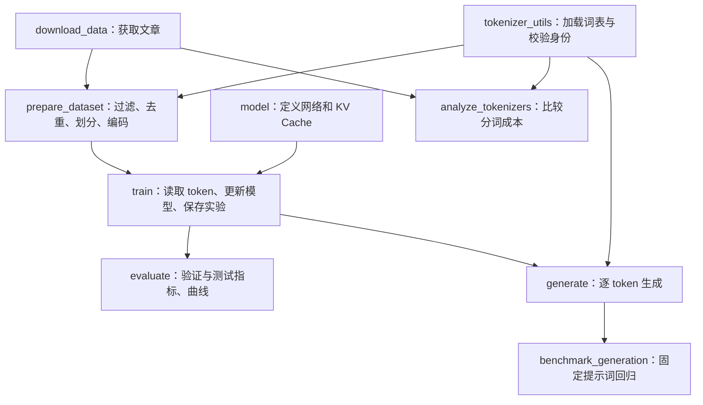

# src 代码讲解：阅读导航

本目录对应 2026-09-14 检查到的源代码，共 12 份逐文件讲解。每份先介绍整个文件的职责、输入输出和执行流程，再展开函数、数据结构、原理、用法与容易误解的细节。它们说明当前实现；“边界”部分不代表相关改进已经完成。

## 先认识项目

项目训练的是中文自回归语言模型：输入前面的 token，预测下一个 token。训练材料来自文章，监督标签由文章自身错开一位得到。模型没有自动获得问答模板、工具调用或 Agent 能力，当前 src 也没有 SFT 入口。



`config_utils` 为七个命令行流程提供配置；`experiment_utils` 管理训练、评估、生成共同使用的实验路径。`__init__` 声明 Python 包。

## 建议阅读顺序

| 顺序 | 文档 | 读完要能回答 |
|---|---|---|
| 1 | [__init__.py](__init__.md) | 为什么用 python -m src.xxx？ |
| 2 | [config_utils.py](config_utils.md) | 参数最终来自哪里？ |
| 3 | [download_data.py](download_data.md) | 原始文章如何成为 JSONL？ |
| 4 | [tokenizer_utils.py](tokenizer_utils.md) | 字符怎样对应 token ID，如何防止词表错配？ |
| 5 | [prepare_dataset.py](prepare_dataset.md) | 文档怎样变成可训练样本？ |
| 6 | [model.py](model.md) | 一次前向传播中张量怎样变化？ |
| 7 | [experiment_utils.py](experiment_utils.md) | 模型与实验保存在哪里？ |
| 8 | [train.py](train.md) | Loss 怎样变成参数更新？ |
| 9 | [evaluate.py](evaluate.md) | PPL、准确率和生成速度有什么区别？ |
| 10 | [generate.py](generate.md) | 模型怎样持续生成，为什么会重复？ |
| 11 | [benchmark_generation.py](benchmark_generation.md) | 如何固定条件比较生成结果？ |
| 12 | [analyze_tokenizers.py](analyze_tokenizers.md) | 分词效率如何影响词表成本与上下文？ |

时间有限时先读各文档的“总体描述”，再深入 `prepare_dataset → model → train → generate` 四个核心模块。

## 本项目的三个关键约定

1. token 不等于汉字，也不等于英文单词；其含义由 tokenizer 决定。
2. 数据、checkpoint 和生成阶段必须保持 token ID 语义一致，不能随意更换 tokenizer。
3. 模型代码的默认值、JSON 默认配置、已训练 checkpoint 是三套不同来源；恢复模型应相信 checkpoint 的架构。

当前 JSON 训练默认值为 512 维、8 层、8 头、SwiGLU 中间维 1536，词表为 21128 时约 38.09M 参数；`MiniGPTConfig()` 的类默认值仍为 384 维、6 层、6 头、中间维 1024，约 18.73M。直接调用 Python 函数不会自动加载 JSON。

## 环境与示例

在项目根目录激活按 [快速开始](../../README.md#快速开始) 创建的虚拟环境后，可检查 Python 和 CUDA。

```powershell
python -c "import sys, torch; print(sys.executable); print(torch.cuda.is_available())"
```

示例用于说明操作；下载和预处理会发布数据文件，训练会建立实验目录，阅读文档不需要把所有命令都运行一遍。
